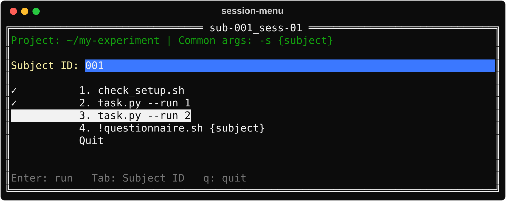

# session-menu

A terminal menu to run the programs of a session, one after the other, with the same subject ID and
the same arguments given to each of them. It works on Linux, Windows and macOS.

Source code, releases and issues: <https://github.com/chrplr/session-menu>



Usage:

```
session-menu [-dir DIR] [-print] [SESSION_FILE]
```

## The project folder

The menu works in a project folder: the current directory, or `DIR` with `-dir DIR`. The programs run
in it, whatever folder the menu was started from. It may hold:

| File or folder | Meaning |
|---|---|
| `bin/` | Programs, looked up before the PATH |
| `sessions/` | Session files (`*.txt`), listed by the menu to choose from |
| `command_line_args.txt` | Arguments given to every program (optional; see below) |
| `.last_subject.txt` | The last subject ID, written by the menu |
| `session-menu-log.csv` | The log of the runs, written by the menu (see below) |

```
cd my-experiment
session-menu                                  # choose a session of sessions/
session-menu sessions/sub-001_sess-01.txt     # or open one directly
```

A session file given on the command line can be anywhere. A relative path is looked for in the
current folder, then in the project folder.

## Session files

A sesssion file is a simple text file, with one command per line: a program, then its options. 
Blank lines and lines starting with `#` are ignored. The options are split as in a shell: quotes and backslashes work. A program may be listed
several times.

```
# sub-001, session 1
!track
MEG-left-right
MEG-ARC -run 1
MEG-ARC -run 2
!python3 tasks/questionnaire.py --subject {subject}
```

- Each program is looked up first in `bin/`, then in the PATH.
- A line starting with `!` is run as written: it does not get the arguments of
  `command_line_args.txt`. Use it for programs that would refuse them, such as `track` above.
- If the file name starts with `sub-<ID>` (up to the first `_` or `.`), the Subject ID field is
  pre-filled with `<ID>`, as written (`sub-001` gives `001`).

Without a session file on the command line, the menu lists the `*.txt` files of `sessions/` to
choose from. If there are none, it lists every program of `bin/`, in alphabetical order.

On Windows, the programs of `bin/` are the `.exe`, `.bat` and `.cmd` files (if two have the same
name, `.exe` first, then `.bat`), and the `.py` files, under their full name, which the menu runs
with Python (`py -3`, or `python` if there is no `py`). A `.bat` file can wrap a script, e.g.
`bin/task_a.bat`:

```bat
@echo off
python "%~dp0task_a.py" %*
```

then `task_a` in a session line runs `task_a.py` with the common arguments and the options of the
line.

## Arguments common to every program

The words of `command_line_args.txt`, if the file exists, are inserted **right after the program** of
every line, except the lines that start with `!`. They are split as the session lines, may span
several lines, and lines starting with `#` are ignored.

`{subject}` is replaced by the Subject ID, in this file and in the session lines (`!` lines
included).

For example, with

```
# command_line_args.txt on the MEG PC
-s {subject}
-d 1 -ttl parallel:/dev/parport1
```

and the Subject ID 7, the session above runs (the menu prints the full paths of the programs):

```
track
bin/MEG-left-right -s 7 -d 1 -ttl parallel:/dev/parport1
bin/MEG-ARC -s 7 -d 1 -ttl parallel:/dev/parport1 -run 1
bin/MEG-ARC -s 7 -d 1 -ttl parallel:/dev/parport1 -run 2
/usr/bin/python3 tasks/questionnaire.py --subject 7
```

Because the options of a line come after the common arguments, a program that keeps the last value
of an option (as Go's `flag` package does) takes the line's value when an option is in both.

Each PC can keep its own `command_line_args.txt`, with its monitor, its trigger device and so on,
while the session files are shared.

## Settings in a configuration file

Settings shared by the programs (the lab, the viewing distance, the monitor, the trigger device…)
can also go into a configuration file of the project, e.g. a TOML file `config.toml`:

```toml
# config.toml
lab = "Example lab"
screen_distance_cm = 60
monitor = 1
```

This keeps the command lines short, and lets the settings have names, types and comments. But
**`session-menu` does not read this file: each program must load and parse it itself**, whatever its
language. So it only suits programs that you write or can change. Programs that you cannot change,
such as `track`, still need their settings on the command line.

- **Python** (3.11 or later) reads TOML with its standard library:

  ```python
  import tomllib

  with open(config_path, "rb") as f:
      config = tomllib.load(f)
  distance = config["screen_distance_cm"]
  ```

- **Go** needs a package, e.g. [go-toml](https://github.com/pelletier/go-toml):

  ```go
  var config struct {
      Lab              string  `toml:"lab"`
      ScreenDistanceCm float64 `toml:"screen_distance_cm"`
  }
  b, err := os.ReadFile(configPath)
  if err == nil {
      err = toml.Unmarshal(b, &config)
  }
  ```

The programs run in the project folder, so they can open `config.toml` by this relative path. A
program that is also started without the menu can look for it from its own location instead, e.g. in
the parent of `bin/`, as the [example project](project/README.md) does.

The two approaches combine well:
- `config.toml` holds the settings of the experiment;
- `command_line_args.txt` holds what changes with each PC or each run, such as `-s {subject}`.

## Use

- In the list of sessions, select one with the arrow keys and press Enter to open it.
- Type the subject ID in the *Subject ID* field: anything without blanks. Press TAB to move to the
  list of programs, and TAB again to come back to the field. Enter in the field also moves to the
  list.
- Select an entry with the arrow keys and press Enter to run it. The menu leaves the screen while the
  program runs, so its output goes to the terminal, and comes back when it ends.
- The command line is printed before it runs.
- When a program succeeds, the cursor moves to the next entry. When it fails, its exit code is shown
  and the menu waits for Enter, so that the output can be read.
- Each entry shows the result of its last run for the Subject ID: `✓` for a success, `✗ exit 2` for
  a failure (`✗ failed` if the program was killed, e.g. by Ctrl-C, or could not be started).
  - The marks come from the log, so they are still there when the menu is restarted. When a session
    opens, the cursor is on the first entry not done.
  - Changing the Subject ID shows the marks of that subject.
- For half a second after a program ends, the menu ignores the keyboard, so that an Enter pressed
  twice to leave a program does not start the next one.
- Esc goes back to the list of sessions. `q`, in a list, quits, as the *Quit* entry does.
- Ctrl-C stops the running program, not the menu.
- The programs also get the subject ID in the environment variable `SUBJECT`.

The header shows the project folder and the common arguments, and the bottom line the keys.

The Subject ID field starts with the ID in the name of the session file, else the value of the
environment variable `SUBJECT`, else the last subject used.

## Log

Every run is appended to `session-menu-log.csv`, in the project folder. It is a CSV file with a header
line, created by the first run:

| Column | Meaning |
|---|---|
| `start`, `end` | When the program started and ended: local time to the millisecond, with the offset from UTC (`2026-10-28T19:54:43.955+01:00`) |
| `duration_s` | `end` − `start`, in seconds |
| `exit_code` | The exit code of the program: 0 for success. −1 if it was killed by a signal (e.g. Ctrl-C) or could not be started |
| `subject` | The Subject ID |
| `session` | The session file: its path from the project folder if it is in it (`sessions/pilot.txt`), else its full path; empty without one |
| `line` | The line of the session file (empty without one) |
| `command` | The command line as it was run |

`end` is taken when the program ends, before the menu waits for Enter after a failure. If the log
cannot be written, the menu says so and goes on. The menu reads the log to mark the entries already
run (see *Use*).

## Example

[project_simple/](project_simple/README.md) is a project folder to try the menu, with nothing to
build: dummy bash and Python scripts, which print their arguments, and two session files (Linux and
macOS).

[project/](project/README.md) is a fuller one: two dummy Python scripts and a dummy Go program, which
read their settings from `config.toml` and print them with their arguments, and three session files.

## Errors

The menu refuses to start, and says why, if:

- the session file cannot be read, or lists no program;
- a program is found in neither `bin/` nor the PATH (with the file and line). If `bin/` has a file of
  that name that is not executable (on Windows: not a `.exe`, `.bat`, `.cmd` or `.py`), the message says so;
- a line or `command_line_args.txt` has an unclosed quote (with the file and line);
- there is no session file, no `sessions/*.txt` and no program in `bin/`.

A session chosen in the list of sessions with one of these errors is not opened: the menu shows the
error.

## Options

| Option | Meaning |
|---|---|
| `-dir DIR` | The project folder (default: the current directory) |
| `-print` | Print the command lines of SESSION_FILE, with the Subject ID and the common arguments filled in, and exit: a check of a session, or of a new PC's `command_line_args.txt`. The Subject ID is the one the menu would start with; `SUBJECT=7 session-menu -print …` sets it (an ID in the file name still wins) |
| `-version` | Print the version and exit |

## Installing

### Ready-to-run programs

Each [release](https://github.com/chrplr/session-menu/releases) has an archive per system. Each
archive holds the program, this README, LICENSE and NOTICE:

| System | Archive |
|---|---|
| Linux (x86-64) | `session-menu_<version>_linux_amd64.tar.gz` |
| Windows (x86-64) | `session-menu_<version>_windows_amd64.zip` |
| macOS, Apple silicon (M1…) | `session-menu_<version>_macos_arm64.tar.gz` |
| macOS, Intel | `session-menu_<version>_macos_amd64.tar.gz` |

`SHA256SUMS` lists their checksums. Unpack the archive, and put `session-menu` (`session-menu.exe` on
Windows) in a folder of the PATH, or run it with its path. It is a terminal program: start it from a
terminal (on Windows, PowerShell or the Command Prompt), not by double-clicking it.

On macOS, the program is not signed. If it was downloaded with a web browser, macOS refuses to run it
("cannot be verified"). Remove the quarantine mark once:

```
xattr -d com.apple.quarantine session-menu
```

### With Go

```
go install github.com/chrplr/session-menu@latest
```

or, from a copy of this repository:

```
go build                     # session-menu (session-menu.exe on Windows)
go test ./...
```

## License

Apache License 2.0 (see [LICENSE](LICENSE) and [NOTICE](NOTICE)).
