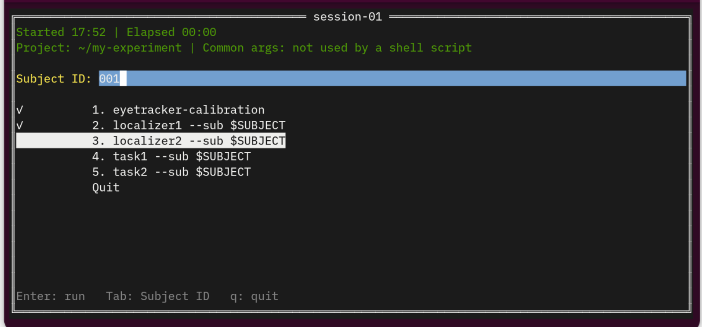

# session-menu

session-menu is a _launcher_ for data acquisition sessions.

In scientific studies, data are often collected across several _sessions_, where each session is a
sequence of _runs_ of data acquisition. For each run, a program is launched to do a calibration,
acquire data, etc.

One way to handle this is to write one script per session, e.g. `session-01.sh`, `session-02.sh`, or
`sub-001_sess-01.sh`…, which lists the programs to launch, in order. For example:

```sh
#!/bin/bash
# session-01.sh
SUBJECT=${SUBJECT:-${1:-000}}   # participant ID

eyetracker-calibration
localizer1 --sub $SUBJECT
localizer2 --sub $SUBJECT
task1 --sub $SUBJECT
task2 --sub $SUBJECT
```

(Several participants can do this session: the environment variable `SUBJECT`, or the first argument
of the script, gives the participant ID.)

Add the line `# runs` above the commands, and session-menu turns this script into a menu:

```sh
#!/bin/bash
# session-01.sh
SUBJECT=${SUBJECT:-${1:-000}}   # participant ID

# runs
eyetracker-calibration
localizer1 --sub $SUBJECT
...
```

```
session-menu session-01.sh
```

Before the session starts, session-menu checks that every program can be found. The experimenter types
the participant ID once, then starts each run from the menu, which shows a timer and which runs are
done:



The program works on Linux, Windows and macOS. Source code, releases and issues: <https://github.com/chrplr/session-menu>

Usage:

```
session-menu [-dir DIR] [-print] [-max-duration-min N] [SESSION_FILE]
```

## Why not just run the script?

The script still works on its own (`bash session-01.sh 007`). Run through session-menu, it also gets:

- **Restart where you stopped.** When a run fails, or the PC crashes, open the session again: the runs
  already done are marked ✓, and the cursor is on the first run not done. No editing of the script,
  no copying of lines.
- **Rerun one run** by selecting it, e.g. after the participant moved.
- **Errors before the participant arrives.** A program that is missing or not executable is reported
  when the session opens, not when run 4 starts.
- **A log of every run** (`session-menu-log.csv`): start, end, duration, exit code, subject, command.
- **The subject ID typed once, and checked.** A script that would replace it with its own value is
  refused, so the data do not go under the wrong subject.
- **Fewer accidents.** Ctrl-C stops the run, not the session, and an Enter pressed twice does not start
  the next run.
- **A timer**, with the time left if you give the planned duration (`-max-duration-min`).

## Quick start

1. Download the archive for your system and put `session-menu` in your PATH (see
   [Installing](#installing)).
2. Try it on the example project of this repository, which has nothing to build (Linux or macOS):

   ```
   git clone https://github.com/chrplr/session-menu
   cd session-menu/project1
   session-menu
   ```

3. Choose a session with the arrow keys and Enter, type a Subject ID, press TAB to go to the list of
   programs, and Enter to run the selected one. Esc goes back, `q` quits. See [Use](#use) for the rest.

## The project folder

The menu works in a project folder: the current directory, or `DIR` with `-dir DIR`. The programs run
in it, whatever folder the menu was started from. We recommend this layout, and starting the menu from
the project folder:

```
project_name/
├── sessions/      the session files
└── bin/           the programs they call (binaries, Python scripts…)
```

The project folder may hold:

| File or folder | Meaning |
|---|---|
| `bin/` | Programs, looked up before the PATH (for `.txt` session files; a shell script does not search it) |
| `sessions/` | Session files (`*.txt`, or shell scripts `*.sh`), listed by the menu to choose from |
| `command_line_args.txt` | Arguments given to every program (optional; see below) |
| `.last_subject.txt` | The last subject ID, written by the menu |
| `session-menu-log.csv` | The log of the runs, written by the menu (see below) |

```
cd project_name
session-menu                                  # choose a session of sessions/
session-menu sessions/sub-001_sess-01.txt     # or open one directly
```

A session file given on the command line can be anywhere. A relative path is looked for in the
current folder, then in the project folder.

## Session files

There are two kinds of session files:

- **`*.txt`**: one command per line, without shell syntax. Start with these: the programs are looked
  up in `bin/`, and they get the arguments of `command_line_args.txt` and the Subject ID (`{subject}`).
- **`*.sh`**: shell scripts, as in the example above. Use them if you already have scripts, or need
  variables and shell syntax. See [Session files that are shell scripts](#session-files-that-are-shell-scripts).

A `.txt` session file is an ordinary text file, with one command per line: a program, then its options.
Blank lines and lines starting with `#` are ignored. The options are split as in a shell: quotes and
backslashes work. A program may be listed several times.

```
# sub-001, session 1
!track
MEG-left-right
MEG-ARC -run 1
MEG-ARC -run 2
!python3 tasks/questionnaire.py --subject {subject}
```

- Each program is looked up first in `bin/`, then in the PATH.
- A line starting with `!` is run as written: it does not get the arguments of
  `command_line_args.txt`. Use it for programs that would refuse them, such as `track` above.
- If the file name starts with `sub-<ID>` (up to the first `_` or `.`), the Subject ID field is
  pre-filled with `<ID>`, as written (`sub-001` gives `001`).

Without a session file on the command line, the menu lists the `*.txt` and `*.sh` files of `sessions/`
to choose from. If there are none, it lists every program of `bin/`, in alphabetical order.

On Windows, the programs of `bin/` are the `.exe`, `.bat` and `.cmd` files (if two have the same
name, `.exe` first, then `.bat`), and the `.py` files, under their full name, which the menu runs
with Python (`py -3`, or `python` if there is no `py`). A `.bat` file can wrap a script, e.g.
`bin/task_a.bat`:

```bat
@echo off
python "%~dp0task_a.py" %*
```

then `task_a` in a session line runs `task_a.py` with the common arguments and the options of the
line.

## Session files that are shell scripts

A session file named `*.sh` is a shell script, which also works without the menu (`sh pilot.sh`). A
comment line `# runs` separates its settings from the commands that the menu lists:

```sh
#!/bin/sh
set -e

# Session parameters
SUBJECT=${SUBJECT:-sub-01}
RIG=configs/rigs/fmri.json

# runs
uv run fmri-play --subject $SUBJECT --rig "$RIG" --run 1
uv run fmri-play --subject $SUBJECT --rig "$RIG" --run 2 \
    --duration 600
```

- Without a line `# runs`, the session does not open. (`# Runs:` and `# Runs, one per line` also work,
  in any case, but not, for example, `# runs are 10 minutes`.)
- Each line below it is one entry of the menu, except blank lines and comments. A line that ends with `\`
  continues on the next. A command over several lines, such as an `if` block, is refused when the session
  is opened, unless it is written on one line.
- For each entry, the menu gives the shell the lines above the comment, then that command. So the
  variables work without `export`, with all of the shell's syntax, as when the script runs on its own.
- **The lines above the comment run again before each entry**, so use them to set things, not to do
  things: `STAMP=$(date +%s)` differs from one entry to the next, and each entry starts with no variable
  set by another entry.
- The shell is the one of the `#!` line (`sh` without one). It must be in the PATH: on Windows, that means
  Git Bash or similar.
- As in any shell script, `bin/` is not searched: write `bin/task.py`.
- Before anything runs, the menu checks each script (see below): it runs the lines above the comment
  once, as an entry would, then looks for the first word of each command. So a program that is missing
  or not executable shows before the session, and so do settings that fail. A `PATH` or a variable set
  in those lines counts. Only the first word is checked: `uv run fmri-play` needs `uv`, but nothing
  tells the menu that `fmri-play` is there. To check more, add it to the settings, which stop the
  session if it fails:

  ```sh
  [ -f "$RIG" ] || { echo "no rig file: $RIG" >&2; exit 1; }
  ```

  A program that an earlier entry creates would be refused, as it does not exist yet.
- `command_line_args.txt` and `{subject}` do not apply: use variables, and `$SUBJECT`.

**Write the subject as `SUBJECT=${SUBJECT:-sub-01}`.** It takes the Subject ID of the menu, and `sub-01`
when the script runs on its own. A plain `SUBJECT=sub-01` would replace the ID typed in the menu, and the
data would go under the wrong subject, so the menu then refuses to start the program, says why, and marks
the entry `✗ exit 3`.

The terminal shows each command with its values (`+ uv run fmri-play --subject 002 ...`). The log and
`-print` have it as written in the script (`--subject $SUBJECT`).

## Arguments common to every program

The words of `command_line_args.txt`, if the file exists, are inserted **right after the program** of
every line, except the lines that start with `!`. They are split as the session lines, may span
several lines, and lines starting with `#` are ignored.

`{subject}` is replaced by the Subject ID, in this file and in the session lines (`!` lines
included).

For example, with

```
# command_line_args.txt on the MEG PC
-s {subject}
-d 1 -ttl parallel:/dev/parport1
```

and the Subject ID 7, the session above runs (the menu prints the full paths of the programs):

```
track
bin/MEG-left-right -s 7 -d 1 -ttl parallel:/dev/parport1
bin/MEG-ARC -s 7 -d 1 -ttl parallel:/dev/parport1 -run 1
bin/MEG-ARC -s 7 -d 1 -ttl parallel:/dev/parport1 -run 2
/usr/bin/python3 tasks/questionnaire.py --subject 7
```

Because the options of a line come after the common arguments, a program that keeps the last value
of an option (as Go's `flag` package does) takes the line's value when an option is in both.

Each PC can keep its own `command_line_args.txt`, with its monitor, its trigger device and so on,
while the session files are shared.

## Settings in a configuration file

Settings shared by the programs (the lab, the viewing distance, the monitor, the trigger device…)
can also go into a configuration file of the project, e.g. a TOML file `config.toml`:

```toml
# config.toml
lab = "Example lab"
screen_distance_cm = 60
monitor = 1
```

This keeps the command lines short, and lets the settings have names, types and comments. But
**`session-menu` does not read this file: each program must load and parse it itself**, whatever its
language. So it only suits programs that you write or can change. Programs that you cannot change,
such as `track`, still need their settings on the command line.

- **Python** (3.11 or later) reads TOML with its standard library:

  ```python
  import tomllib

  with open(config_path, "rb") as f:
      config = tomllib.load(f)
  distance = config["screen_distance_cm"]
  ```

- **Go** needs a package, e.g. [go-toml](https://github.com/pelletier/go-toml):

  ```go
  var config struct {
      Lab              string  `toml:"lab"`
      ScreenDistanceCm float64 `toml:"screen_distance_cm"`
  }
  b, err := os.ReadFile(configPath)
  if err == nil {
      err = toml.Unmarshal(b, &config)
  }
  ```

The programs run in the project folder, so they can open `config.toml` by this relative path. A
program that is also started without the menu can look for it from its own location instead, e.g. in
the parent of `bin/`, as the [example project](project2/README.md) does.

The two approaches combine well:
- `config.toml` holds the settings of the experiment;
- `command_line_args.txt` holds what changes with each PC or each run, such as `-s {subject}`.

## Use

- In the list of sessions, select one with the arrow keys and press Enter to open it.
- Type the subject ID in the *Subject ID* field: anything without blanks. Press TAB to move to the
  list of programs, and TAB again to come back to the field. Enter in the field also moves to the
  list.
- Select an entry with the arrow keys and press Enter to run it. The menu leaves the screen while the
  program runs, so its output goes to the terminal, and comes back when it ends.
- The command line is printed before it runs.
- When a program succeeds, the cursor moves to the next entry. When it fails, its exit code is shown
  and the menu waits for Enter, so that the output can be read.
- Each entry shows the result of its last run for the Subject ID: `✓` for a success, `✗ exit 2` for
  a failure (`✗ failed` if the program was killed, e.g. by Ctrl-C, or could not be started).
  - The marks come from the log, so they are still there when the menu is restarted. When a session
    opens, the cursor is on the first entry not done.
  - Changing the Subject ID shows the marks of that subject.
- For half a second after a program ends, the menu ignores the keyboard, so that an Enter pressed
  twice to leave a program does not start the next one.
- Esc goes back to the list of sessions. `q`, in a list, quits, as the *Quit* entry does.
- Ctrl-C stops the running program, not the menu.
- The programs also get the subject ID in the environment variable `SUBJECT`.

The first line is a timer, in hours and minutes (HH:mm): the time of day the menu was started, the
time elapsed since, and, with `-max-duration-min`, the time remaining. Past that duration, the time
remaining is negative; nothing is stopped. The timer is updated at least every 30 s, and is not on
screen while a program runs.

Below it, the header shows the project folder and the common arguments. The bottom line shows the keys.

The Subject ID field starts with the ID in the name of the session file, else the value of the
environment variable `SUBJECT`, else the last subject used.

## Log

Every run is appended to `session-menu-log.csv`, in the project folder. It is a CSV file with a header
line, created by the first run:

| Column | Meaning |
|---|---|
| `start`, `end` | When the program started and ended: local time to the millisecond, with the offset from UTC (`2026-10-28T19:54:43.955+01:00`) |
| `duration_s` | `end` − `start`, in seconds |
| `exit_code` | The exit code of the program: 0 for success. −1 if it was killed by a signal (e.g. Ctrl-C) or could not be started |
| `subject` | The Subject ID |
| `session` | The session file: its path from the project folder if it is in it (`sessions/pilot.txt`), else its full path; empty without one |
| `line` | The line of the session file (empty without one) |
| `command` | The command line as it was run |

`end` is taken when the program ends, before the menu waits for Enter after a failure. If the log
cannot be written, the menu says so and goes on. The menu reads the log to mark the entries already
run (see *Use*).

## Example

[project1/](project1/README.md) is a project folder to try the menu, with nothing to
build: dummy bash and Python scripts, which print their arguments, and two session files (Linux and
macOS).

[project2/](project2/README.md) is a fuller one: two dummy Python scripts and a dummy Go program, which
read their settings from `config.toml` and print them with their arguments, and three session files.

`project3/sessions/` has session files that are shell scripts, for a program that is not in this
repository (`fmri-play`), so they are examples to read, not to run.

## Errors

The menu refuses to start, and says why, if:

- the session file cannot be read, or lists no program;
- a program is found in neither `bin/` nor the PATH (with the file and line). If `bin/` has a file of
  that name that is not executable (on Windows: not a `.exe`, `.bat`, `.cmd` or `.py`), the message says so;
- a line or `command_line_args.txt` has an unclosed quote (with the file and line);
- a session file that is a shell script has no `# runs` line, nothing below it, a command that is not
  whole, a program that is not found or not executable, lines above `# runs` that fail or take more than
  30 s, or a shell that is not in the PATH;
- there is no session file, no `sessions/*.txt` or `*.sh`, and no program in `bin/`.

The menu checks every session file of the list of sessions when it starts. One with an error stays in
the list, with `✗` and the error, and the others still work. It cannot be opened: choosing it shows the
whole error.

## Options

| Option | Meaning |
|---|---|
| `-dir DIR` | The project folder (default: the current directory) |
| `-print` | Print the command lines of SESSION_FILE, with the Subject ID and the common arguments filled in, and exit: a check of a session, or of a new PC's `command_line_args.txt`. The Subject ID is the one the menu would start with; `SUBJECT=7 session-menu -print …` sets it (an ID in the file name still wins) |
| `-max-duration-min N` | The planned duration of the session, in minutes: the menu also shows the time remaining (default: no limit). It only informs: nothing is stopped when the time is over |
| `-version` | Print the version and exit |

## Installing

### Ready-to-run programs

Each [release](https://github.com/chrplr/session-menu/releases) has an archive per system. Each
archive holds the program, this README, LICENSE and NOTICE:

| System | Archive |
|---|---|
| Linux (x86-64) | `session-menu_<version>_linux_amd64.tar.gz` |
| Windows (x86-64) | `session-menu_<version>_windows_amd64.zip` |
| macOS, Apple silicon (M1…) | `session-menu_<version>_macos_arm64.tar.gz` |
| macOS, Intel | `session-menu_<version>_macos_amd64.tar.gz` |

`SHA256SUMS` lists their checksums. Unpack the archive, and put `session-menu` (`session-menu.exe` on
Windows) in a folder of the PATH, or run it with its path. It is a terminal program: start it from a
terminal (on Windows, PowerShell or the Command Prompt), not by double-clicking it.

On macOS, the program is not signed. If it was downloaded with a web browser, macOS refuses to run it
("cannot be verified"). Remove the quarantine mark once:

```
xattr -d com.apple.quarantine session-menu
```

### With Go

```
go install github.com/chrplr/session-menu@latest
```

or, from a copy of this repository:

```
go build                     # session-menu (session-menu.exe on Windows)
go test ./...
```

## License

Apache License 2.0 (see [LICENSE](LICENSE) and [NOTICE](NOTICE)).
